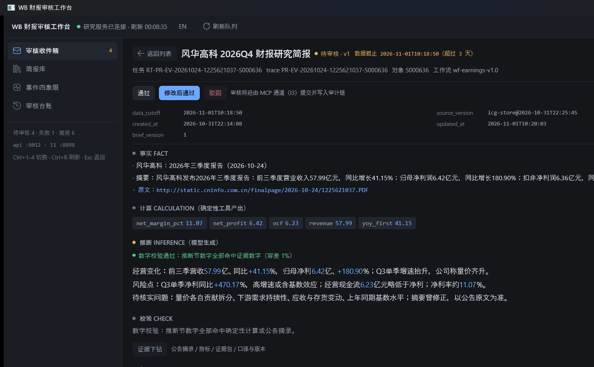
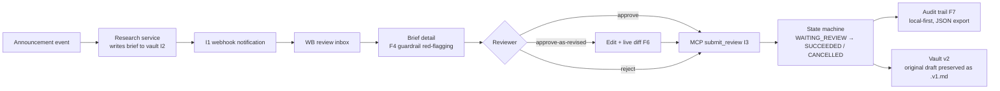
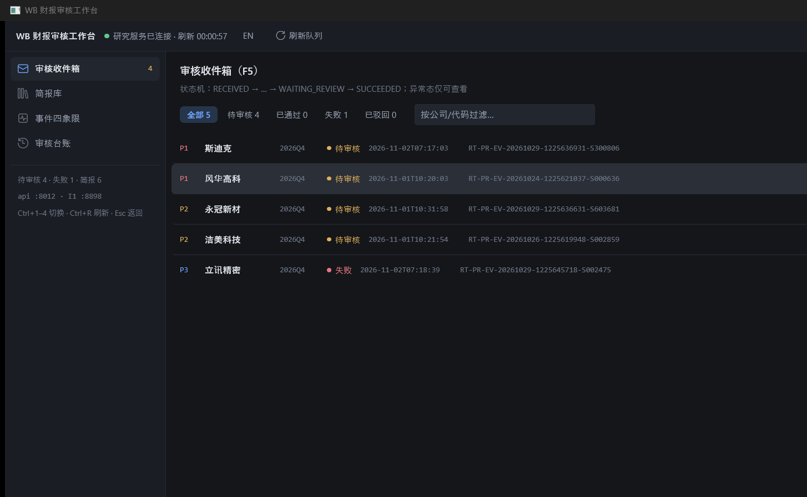
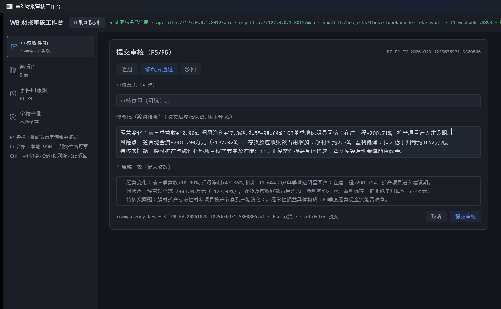

# WB 财报审核工作台 · Financial-Report Review Workbench

A Windows desktop workbench (Rust + GPUI) implementing the **WB review closed loop** from the
thesis interface contract: the *read → trust → review → trace* pipeline for LLM-generated
earnings-report research briefs, built around one discipline —

> **The model never decides.** Every number that appears in model-generated text must trace
> back to an evidence number (deterministic tool output or an announcement excerpt). Anything
> that doesn't is red-flagged for the human reviewer before anything is published.



## Why this exists

An LLM writes a research brief from a company announcement. It looks authoritative. Some of its
numbers are *quoted* from the announcement; others are *computed by the model on the fly* — and
those are exactly the ones that can be quietly wrong. WB makes that difference visible:

- **斯迪克 2026Q3**: the model wrote 「扣非低于归母约 **1652万**」. That figure appears nowhere in
  the evidence — it is the model's own subtraction (0.669378 − 0.504206 ≈ 0.1652亿). The
  guardrail flags it; the reviewer sees it red-underlined with a tooltip before approving.
- The corrected rewrites that quote announcement numbers directly pass.

The guardrail is deterministic (no LLM in the loop): 万/亿 scale-aware numeric extraction,
1% relative / 0.02pp absolute tolerance, differences and computed ratios never count as evidence.

## The closed loop



The reviewer can approve, approve-as-revised (edit the INFERENCE section with a live diff;
the original draft stays untouched in the vault as `{task_id}.v1.md` and the version bumps),
or reject. Every submission goes out over the MCP channel (I3) with an idempotency key, is
reconciled against version conflicts (409), and lands in a local audit log that survives
service outages.

## Features (thesis function list F1–F12)

| # | Function | Implementation |
|---|---|---|
| F1 | Brief library + full-text search | `wb-app` library view over the I2 vault |
| F2 | Brief detail — FACT / CALCULATION / INFERENCE / CHECK | `wb-app/src/detail.rs` |
| F3 | Data-cutoff badge (amber after 3 days) | `detail.rs::cutoff_badge` |
| F4 | Numeric guardrail red-flagging | `wb-core/src/guardrail.rs` |
| F5 | Review inbox (status/company filters) | `wb-app/src/workspace.rs` |
| F6 | Approve-as-revised + live diff + version bump | `wb-core/src/diff.rs` + review modal |
| F7 | Local-first audit trail, JSON export | `wb-core/src/audit.rs` |
| F8 | MCP channel (approval policy, timeout, structured errors) | `wb-core/src/research.rs` |
| F9 | New-brief webhook notification (I1, idempotent) | `wb-core/src/webhook.rs` |
| F10 | Degraded-service display (queue shows unavailable, never blank) | `workspace.rs` |
| F11 | Evidence drill-down (announcement / metrics / evidence pack) | `detail.rs` evidence panel |
| F12 | Event quadrant (P1–P4 importance × urgency) | `wb-core/src/state.rs` + quadrant view |

UI is bilingual (EN / 中文, one keystroke to switch) via `wb-app/src/i18n.rs`.

## Repo layout

```
Ref+Fun+MockData/          # thesis spec: interface contract v3, function/interface list,
                           # and per-endpoint mock data captured from real runs
workbench/
├── crates/
│   ├── wb-core/           # pure logic: contract-v3 models, I2 vault parser (13 frontmatter
│   │                      # fields + four sections), F4 guardrail, F6 diff, F7 audit,
│   │                      # F8 MCP client (I3 tools/call), I1 webhook listener
│   ├── wb-mock/           # stand-in KG-Palantir research service: serves the vendored
│   │                      # real-run fixtures with live state transitions, 409 conflicts,
│   │                      # idempotent replay, v2 writes into the vault
│   ├── wb-app/            # the GPUI desktop app (Windows)
│   └── wb-e2e/            # end-to-end suite over real HTTP
├── vendor/api_mock/       # fixtures the mock service serves
├── research-vault/        # I2 vault: research/{yyyy-mm}/{task_id}.md briefs
└── screenshots/           # captured evidence of the live app
```

**WB-side channels** (from the contract): **I1** HTTP webhook KG→WB (pure trigger, payload not
consumed, idempotent) · **I2** vault file contract (research writes, WB reads) · **I3** four MCP
tools (`submit_review` / `get_task` / `get_context` / `list_pending`) — the review write path.

## Run it

Requires Rust (stable) and Windows.

```bash
# terminal 1 — the stand-in research service
cd workbench
cargo run -p wb-mock -- --port 8012 --api-mock vendor/api_mock --vault research-vault

# terminal 2 — the workbench
cargo run -p wb-app                # add --view library|quadrant|audit to start on a view
```

Config via `wb.config.json` or env: `WB_API_BASE`, `WB_MCP_URL`, `WB_VAULT`, `WB_DATA`,
`WB_WEBHOOK_PORT` (default 8898), `WB_REVIEWER`, `LANG`.

Keyboard: `Ctrl+1–4` switch views · `Ctrl+R` refresh queue · `Esc` back / close review form ·
`Ctrl+Enter` submit the review form.

To exercise the I1 webhook push path:

```bash
cargo run -p wb-mock -- --port 8012 --api-mock vendor/api_mock --vault research-vault \
    --webhook-url http://127.0.0.1:8898/webhook/i1
curl -X POST http://127.0.0.1:8012/__test/emit_webhook -d '{"task_id":"RT-PR-EV-20261029-1225636931-S300806"}'
```

## Verify

```bash
cd workbench
cargo test                         # 14 unit tests (wb-core) + 5 e2e tests (wb-e2e)

cargo run -p wb-app -- --selfcheck         # opens the real window, renders 4s, exits 0

# UI end-to-end: drives the FULL review loop through the real UI against a running service —
# open task → guardrail flags 「1652万」 → review modal (修改后通过) → edit → submit via MCP
# → asserts SUCCEEDED at brief v2, audit record written, queue updated, vault v2 clean.
WB_VAULT=research-vault WB_DATA=wb-data cargo run -p wb-app -- --selfcheck-e2e
# prints: SELFCHECK_E2E_OK
```

E2E coverage: full approve loop · revise flow (v1 preserved, violation cleared) · 409 conflict
on failed task and unknown object · degraded-service transport errors · queue/quadrant contract.

## Screenshots

| | |
|---|---|
|  |  |
| Review inbox (F5) — queue with status/company filters | Review modal (F5/F6) — approve-as-revised with live diff, idempotency key |

## Docs

- [`Ref+Fun+MockData/WB-KG-Interface-Contract-v3.md`](Ref+Fun+MockData/WB-KG-Interface-Contract-v3.md)
  — channels I1–I9, adopt/adapt/reject traceability for every API-list entry
- [`Ref+Fun+MockData/WB-Function-Interface-List-final.md`](Ref+Fun+MockData/WB-Function-Interface-List-final.md)
  — the final function list (F1–F12) and interface verdicts
- [`workbench/README.md`](workbench/README.md) — developer-oriented notes and known limitations

## Known limitations

- Text inputs accept keystrokes + clipboard paste; IME composition (Chinese typing) is not
  wired up in this build — review comments can be pasted.
- The mock service is a stand-in: single-threaded, in-memory state; its queue is generated
  from the loaded fixtures rather than the static `analysis_history` file.
- gpui 0.2.2 layout quirks on Windows (grow items must be the last flex child; absolute
  insets are DPI-offset) are worked around in `workspace.rs` / `detail.rs`.
