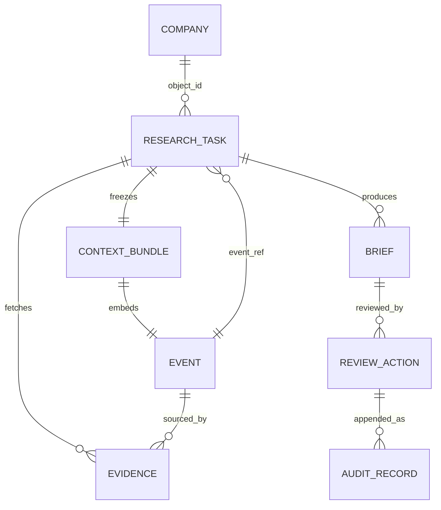

# Chapter 4 (draft) — The Knowledge Model

Status: draft, 2026-11-18. Converts the professor's spec §1.1–1.2 into a documented model over
the existing implementation. **No new code is required for the table below**; every entity is
already a Rust struct in `wb-core`. What was missing is the model written down as a model.

Scope note: §1.3 of the spec (embedded SQLite, entity extraction, Neo4j comparison) is **not**
implemented and is not claimed here. See §4.5.

---

## 4.1 Entities

Seven entity types. For each: the spec name, the Rust type that carries it, its fields, and where
it is defined.

| # | Entity (§1.1) | Rust type | Fields | Location |
|---|---|---|---|---|
| 1 | **Company** | `Company` | `object_id`, `name`, `ticker`, `exchange`, `sector` | `wb-core/src/model.rs:204-214` |
| 2 | **Event** | `Announcement` | `event_id`, `title`, `event_date`, `event_type`, `source_url`, `summary`, `pct_change` | `model.rs:187-201` |
| 3 | **Evidence** | `Evidence` | `event_id`, `source_url`, `excerpt`, `locator`, `fetched_at` | `model.rs:234-244` |
| 4 | **ResearchTask** | `TaskSummary` (queue row) + `TaskDetail` (full payload) | summary: `task_id`, `object_id`, `object_name`, `period`, `status`, `title`, `priority`, `created_at`, `updated_at`, `fail_reason` · detail adds: `trace_id`, `workflow_version`, `data_cutoff`, `source_version`, `sections`, `history`, `brief_path`, `brief_version` | `model.rs:42-62`, `:152-184` |
| 5 | **ContextBundle** | `ContextBundle` | `task_id`, `data_cutoff`, `source_version`, `announcement`, `company`, `metrics` | `model.rs:218-230` |
| 6 | **ReviewAction** | `ReviewRequest` (submitted) + `ReviewReceipt` (acknowledged) + `AuditRecord` (persisted) | request: `task_id`, `verdict`, `comment`, `reviewer`, `idempotency_key`, `revised_sections` · receipt: `ok`, `review_id`, `status`, `brief_version`, `trace_id`, `reviewed_at`, `note` · audit: `ts`, `task_id`, `object_name`, `period`, `verdict`, `reviewer`, `comment`, `revised`, `receipt`, `review_id`, `status_after`, `trace_id`, `guardrail_tokens`, `original_inference`, `revised_inference` | `model.rs:313-322`, `:325-337`, `audit.rs:11-38` |
| 7 | **Artifact (research brief)** | `Brief` + `Frontmatter` + `BriefSections` | brief: `path`, `frontmatter`, `title`, `sections` · frontmatter: 13 fields (`task_id`, `trace_id`, `event_ref`, `object_id`, `object_version`, `period`, `workflow_version`, `status`, `review_comment`, `reviewer`, `created_at`, `data_cutoff`, `source_version`) · sections: `fact`, `calculation`, `inference`, `check` | `vault.rs:35-40`, `model.rs:11-27`, `:114-123` |

Two types are deliberately **not** counted as ontology entities: `Stock` (`model.rs:273-283`, a
catalogue record with a `listed` flag, superseded by `Company` in the review path) and
`HistoryEntry` (`model.rs:30-38`, a value object carried inside ResearchTask). Listing them as
entities would inflate the count without adding a relation.

## 4.2 Relations

| # | Relation (§1.2) | Realised by | Strength |
|---|---|---|---|
| R1 | Company → Task (`owns`) | `TaskSummary.object_id` → `Company.object_id` | field reference; no FK enforcement |
| R2 | Event → Task (`triggers`) | `Frontmatter.event_ref` on the brief; `ContextBundle.announcement.event_id` | **indirect** — `TaskDetail` itself carries no `event_id` |
| R3 | Task → Evidence (`cites`) | `Evidence.event_id` → `Announcement.event_id`, with evidence fetched per task at `/audit/{task_id}/evidence` | **path-addressed**, not stored — the link is the URL |
| R4 | Brief lineage v1 → v2 | `TaskDetail.brief_version: Option<u64>` + `{task_id}.v1.md` retained beside `{task_id}.md` | real, and exercised by test |
| R5 | Review state transitions | `HistoryEntry { at, from, to, note }` per task; `TaskState` (10 states) in `state.rs:6-17` | real |
| R6 | Append-only audit chain | `AuditRecord` appended via `OpenOptions::append(true)` (`audit.rs:57-60`) | **append-only, not a chain** — no `prev_hash` or digest field exists |

Figure 4.1 — The seven entities and their relations. Solid edges are stored references; R2 and R3
are the two edges that are carried indirectly (see table).

## 4.3 Cardinalities and versioning

- One company has many tasks (one per reporting period); one task produces exactly one brief.
- A brief is versioned, not overwritten: v1 stays on disk as `{task_id}.v1.md` and the reviewed
  text becomes v2 at `{task_id}.md`. `brief_version` records which is current.
- One task has many `HistoryEntry` transitions but at most one terminal `ReviewAction` per version.
- `ContextBundle` is a **frozen snapshot**: `data_cutoff` and `source_version` are captured at
  bundle creation and never re-resolved, so a review decision is always attributable to a specific
  data state.

## 4.4 Persistence as implemented

| Store | Format | Path |
|---|---|---|
| Briefs | versioned Markdown, 13-field frontmatter + 4 fixed sections | `{vault}/research/{yyyy-mm}/{task_id}.md` (`vault.rs:1-3`) |
| Review audit | JSONL, one record per line, append-only | `wb-data/reviews.jsonl` (`audit.rs:53-64`) |
| Everything else (tasks, events, evidence, context) | served over HTTP by the research service; the workbench holds no database | `wb-mock` fixtures in development |

## 4.5 What this model does **not** include

Stated here rather than left for an examiner to find.

1. **No embedded SQLite (§1.3) — by assignment, not by omission.** The supervisor confirmed on
   2026-11-18 that the ontology database is their deliverable; this workbench is the other side of
   the API. The persistence layer here is a Markdown vault (I2) plus a JSONL audit log (F7), which is
   what the interface contract requires of the workbench. Entity extraction from cninfo happens in
   the research service, not in this repository. What this chapter documents is therefore the
   *consumer* half of the ontology: the seven shapes the workbench reads and writes, which must match
   the service's schema. Obtaining that schema and diffing it against §4.1 is open work.
2. **No hash chain (§1.2).** The audit log is append-only and survives service outages, but no
   record commits to its predecessor's digest, so it is not tamper-evident. Adding
   `prev_hash`/`record_hash` is a small change (see backlog T-06) and would make the §1.2 wording
   literally true.
3. **No graph query.** R1–R3 are field references resolved in application code. There is no
   queryable graph store, so "Neo4j for comparison" is a design alternative that was not taken.
4. **The ontology is documented, not declared.** There is no OWL/RDF file and no schema artefact
   beyond this chapter and the Rust type definitions. §1.1 is satisfied in the design sense — a
   defined entity/relation model that the implementation conforms to — not in the
   machine-readable sense.

## 4.6 Why this is a knowledge model and not just a set of structs

The model earns the name because it fixes three invariants the system relies on:

- **Every claim has an owner.** A number in a brief belongs either to an `Event` (announcement
  excerpt) or to a `ContextBundle.metrics` computation — never to the model. This is the invariant
  the guardrail enforces mechanically in Chapter 5.
- **Every decision has provenance.** A `ReviewAction` names the reviewer, the version it acted on,
  and the `guardrail_tokens` visible at the moment of decision.
- **Nothing is overwritten.** Briefs version, the audit log appends, and `ContextBundle` freezes.
  The state at review time is reconstructible from the model, which is what makes the evaluation
  in Chapter 6 reproducible.

## 4.7 The guardrail as three layers

Worth stating explicitly, because "numeric guardrail" in §2.1 now refers to a pipeline rather than a
single function, and an examiner will ask which part produces the red mark.

| Layer | Module | Question answered | Deterministic |
|---|---|---|---|
| 1 · numeric traceability | `guardrail.rs` | Does this number appear anywhere in the evidence? | yes |
| 2 · structural consistency | `structural.rs` | Do the CALCULATION figures satisfy the accounting identities? | yes |
| 3 · provenance (advisory) | `provenance.rs` | *Which* source sentence supports this number? | yes |

Layers 1 and 2 produce verdicts. Layer 3 produces explanations and cannot clear a flag — it consumes
layer 1's span set, so the two cannot disagree (`citation_set_equals_guardrail_violation_set`).
No layer contains an LLM. That is the invariant the thesis rests on: a reviewer can be wrong, a model
can be wrong, but the checker is reproducible.
